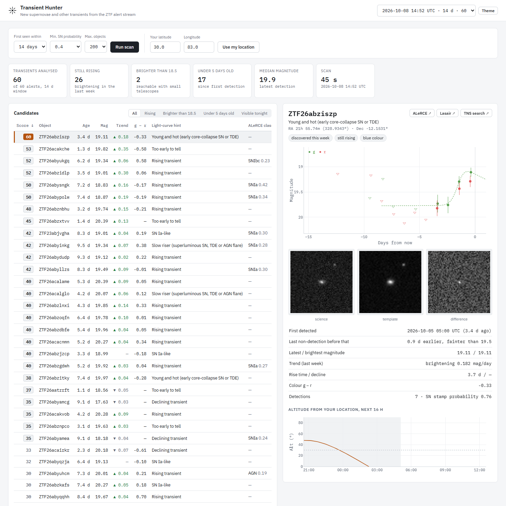

# Transient Hunter

Pulls new supernova candidates from the Zwicky Transient Facility alert stream (via the ALeRCE broker),
fits their light curves and ranks them by how worthwhile follow-up observations would be right now.



## Usage

```bash
./run.sh        # Linux / macOS / WSL
run.bat         # Windows
```

Open http://localhost:8003. A scan runs on start-up if the last one is older than 12 hours.

## What it does

1. Queries ALeRCE for alerts whose image cut-outs look like supernovae, first seen in the last 7–30 days.
2. Downloads each light curve (detections and upper limits) and fits a Bazin model per band.
3. Measures age, latest and peak magnitude, recent trend, rise time, decline rate and g − r colour.
4. Gives a light-curve type hint (SN Ia-like, plateau, fast, young and hot, slow riser) next to the
   ALeRCE classifier result.
5. Scores each object for follow-up: brightness, youth, still rising, colour, recent detections.
6. Computes how many dark hours each object is above 30° altitude tonight from your location.

The detail view shows the light curve with fits, ZTF science / reference / difference cut-outs,
an altitude chart for tonight, and links to ALeRCE, Lasair and the Transient Name Server.

## Contributing findings

Each object has a Contribute panel that works with the Transient Name Server (TNS), where transients are
officially named and credited:

1. Check TNS for an existing report at that position (needs a free TNS bot: id, name, API key).
2. Report it as a new transient if nobody has: an AT report built from the public ZTF photometry, with ZTF as
   the data source and you as the reporter. Reviewed as JSON before sending; sandbox by default.
3. Report your own follow-up photometry (filters and instruments from the TNS value tables).
4. Draft an AstroNote for the TNS AstroNotes page.
5. Links to citizen-science projects that credit volunteers in discovery reports.

The "Share this scan" card downloads the ranked list as a package or publishes it on Zenodo with a DOI.

## Limitations

- Type hints are based on light-curve shape and colour only; a spectrum is needed to classify.
- TNS checks and reports need your own TNS bot credentials.
- Observability ignores the Moon and local horizon.
